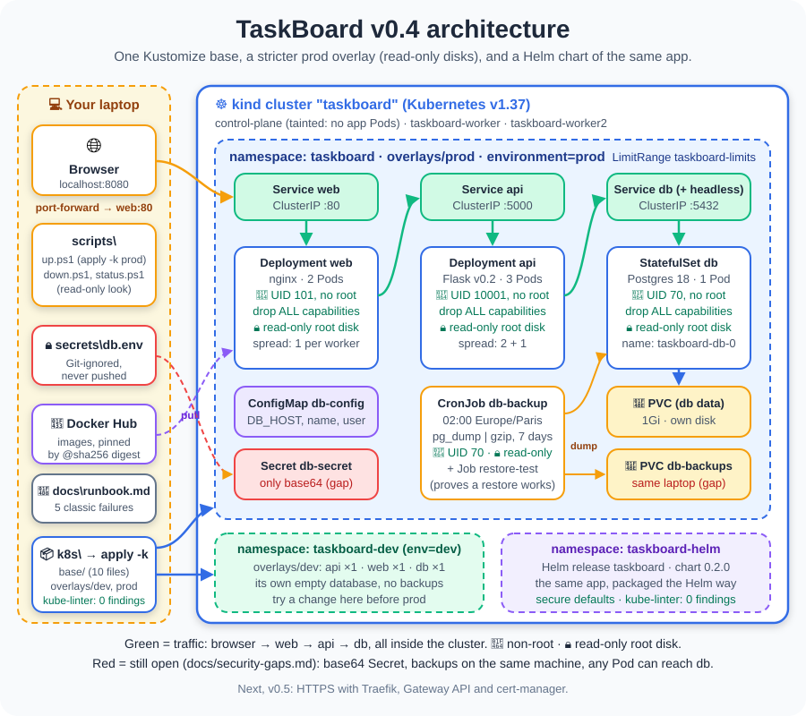

# TaskBoard — a secure GitOps platform on Kubernetes

A tiny to-do app (web page + API + database) running on a secured,
automated Kubernetes platform that I am building from zero.

## Status
✅ v0.1: the app runs in containers.
✅ v0.2: the app runs on Kubernetes (a local kind cluster).
✅ v0.3: the database keeps its data on a disk, is backed up every night, and every Pod runs as non-root,
spread over 2 nodes. Known security gaps: [docs/security-gaps.md](docs/security-gaps.md).
✅ v0.4: the Kubernetes files are a Kustomize base with a `dev` and a stricter `prod` overlay (read-only root
disks, nightly backups), and the same app is also a Helm chart. Both pass kube-linter with no findings.

## Run on Kubernetes
Needs Docker Desktop, `kind` and `kubectl`.

1. Make the private password file `secrets/db.env` once (it is Git-ignored), with one line:
   `POSTGRES_PASSWORD=<a long random password>`
2. Build everything (cluster, namespace, Secret, app) with one command: `.\scripts\up.ps1`
   (it applies the prod overlay: `kubectl apply -k k8s\overlays\prod`)
3. Open a tunnel: `kubectl port-forward -n taskboard svc/web 8080:80`, then open http://localhost:8080
4. Smoke test, in another terminal: `Invoke-RestMethod http://localhost:8080/api/health` → `ok 0.2`
5. Remove it all: `.\scripts\down.ps1`

`up.ps1` is safe to run again: a second run only says `unchanged`.

## Environments (Kustomize)
One recipe, a sticky note per environment. `k8s/base/` holds the 10 shared files (no namespace written in
them). Each overlay changes only what differs:

| Overlay | Namespace | What it changes |
|---------|-----------|-----------------|
| `k8s/overlays/dev` | `taskboard-dev` | 1 api, 1 web, label `environment=dev`, no backups: for trying a change first |
| `k8s/overlays/prod` | `taskboard` | label `environment=prod`, nightly backups, and `lock.yaml`: a read-only root disk on every container |

- See what an overlay would change, without changing anything: `kubectl diff -k k8s\overlays\prod`
- Dev needs its own Secret first: `kubectl create namespace taskboard-dev`, then
  `kubectl create secret generic db-secret -n taskboard-dev --from-env-file=secrets\db.env`, then
  `kubectl apply -k k8s\overlays\dev`
- Lint what you ship: `kubectl kustomize k8s\overlays\prod | kube-linter lint -` (no lint errors)
- Always `-k` on these folders, never `-f`.

## Database backups
A CronJob (`k8s/overlays/prod/db-backup-cronjob.yaml`, prod only) dumps the database every night at 02:00 (Paris time) into its own
volume, and keeps 7 days of backups.

- Run a backup now: `kubectl create job --from=cronjob/db-backup backup-now -n taskboard`
- Prove the newest backup can be restored (into a scratch database, the real data is not touched):
  `kubectl apply -f jobs\restore-test.yaml`, then `kubectl logs job/restore-test -n taskboard`

Known limits: the backups live on the same machine as the data and are not encrypted yet
(see [docs/security-gaps.md](docs/security-gaps.md)).

## Install with Helm
The same TaskBoard is also packaged as a Helm chart in `charts/taskboard/` (chart `0.2.0`, app `0.2`).
It is secure by default: with no values at all, every Pod is non-root with all capabilities dropped and a
read-only root disk, every Service is internal, nightly backups are on, and the backup disk survives
`helm uninstall`. Backups can be switched off (`backup.enabled`) and their age set (`backup.keepDays`).

1. Make the namespace and the password Secret first (the chart never takes a password as a value):
   `kubectl create namespace taskboard-helm`, then
   `kubectl create secret generic db-secret -n taskboard-helm --from-env-file=secrets\db.env`
2. Install: `helm install taskboard charts\taskboard -n taskboard-helm`
3. Check it before installing, without touching the cluster: `helm lint charts\taskboard` and
   `helm template taskboard charts\taskboard -n taskboard-helm`
4. Lint it like a reviewer would: `kube-linter lint charts\taskboard` (no lint errors; the one ignored check
   has its reason written on the object)

## When something breaks
Run `.\scripts\status.ps1` first. It only reads: nodes, Pods, restarts with the last exit code, the Pods
behind each Service, and recent warnings. Then follow the [runbook](docs/runbook.md).

## Run with Docker Compose
1. Copy `.env.example` to `.env`, then change the password
2. `docker compose up -d`
3. Open http://localhost:8080

Images: [dhiasalah on Docker Hub](https://hub.docker.com/u/dhiasalah)

## Project structure
- `app/api/`: the Python API
- `app/frontend/`: the web page
- `docs/`: diagrams, design decisions, the [network plan](docs/network-plan.md) and the [runbook](docs/runbook.md)
- `k8s/base/`: the shared Kubernetes manifests (Deployments for web and api, a StatefulSet with its own disk for Postgres, Services, ConfigMap, LimitRange)
- `k8s/overlays/`: `dev` (small, no backups) and `prod` (read-only lock, nightly backup CronJob and its disk)
- `charts/taskboard/`: the Helm chart (templates with holes + safe default values)
- `helm-test/`: values for the podinfo test release (learning Helm)
- `jobs/`: Jobs I run by hand, like the backup restore test
- `cluster/`: the kind cluster config (1 control plane + 2 workers)
- `scripts/`: helper scripts: `up.ps1`, `down.ps1`, and `status.ps1` (read-only first look)
- `docker-compose.yml`: starts everything
- `CHANGELOG.md`: what changed in each version

## Why this project
I am learning DevSecOps to become a DevSecOps engineer, and I learn best by building one real project from start to finish.

## Author
Ben Salah Mohamed Dhia, learning DevSecOps step by step. See JOURNEY.md.
