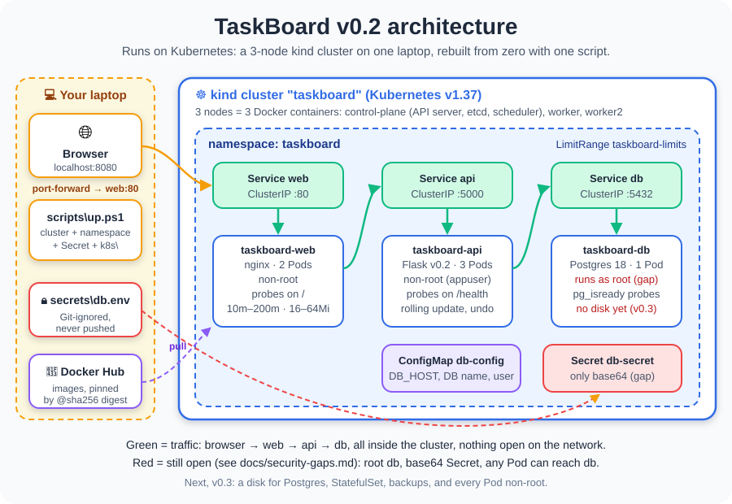

# TaskBoard — a secure GitOps platform on Kubernetes

A tiny to-do app (web page + API + database) running on a secured,
automated Kubernetes platform that I am building from zero.

## Status
✅ v0.1: the app runs in containers. Next: Kubernetes.

## Run it
1. Copy `.env.example` to `.env`, then change the password
2. `docker compose up -d`
3. Open http://localhost:8080

Images: [dhiasalah on Docker Hub](https://hub.docker.com/u/dhiasalah)

## Project structure
- `app/api/`: the Python API
- `app/frontend/`: the web page
- `docs/`: diagrams and design decisions, starting with the [network plan](docs/network-plan.md)
- `scripts/`: helper scripts
- `docker-compose.yml`: starts everything
- `CHANGELOG.md`: what changed in each version

## Why this project
I am learning DevSecOps to become a DevSecOps engineer, and I learn best by building one real project from start to finish.

## Author
Ben Salah Mohamed Dhia, learning DevSecOps step by step. See JOURNEY.md.
